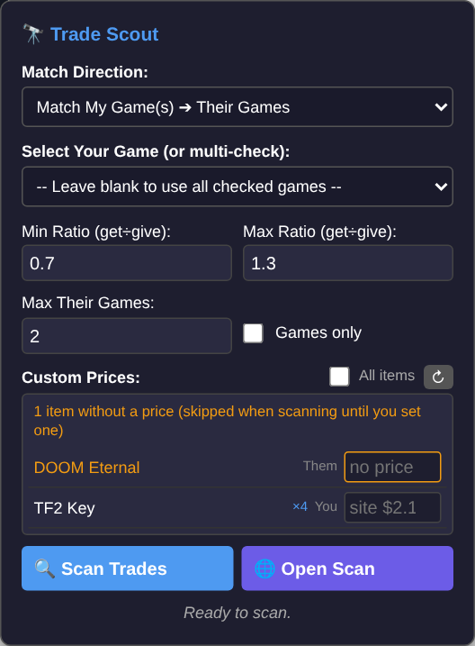
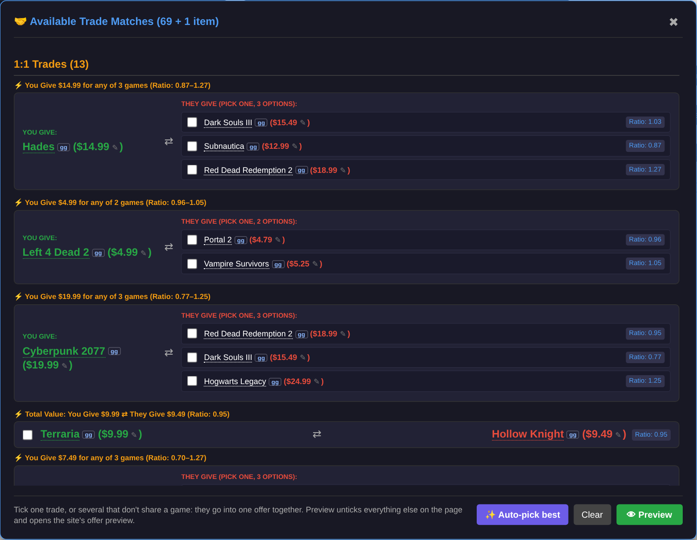
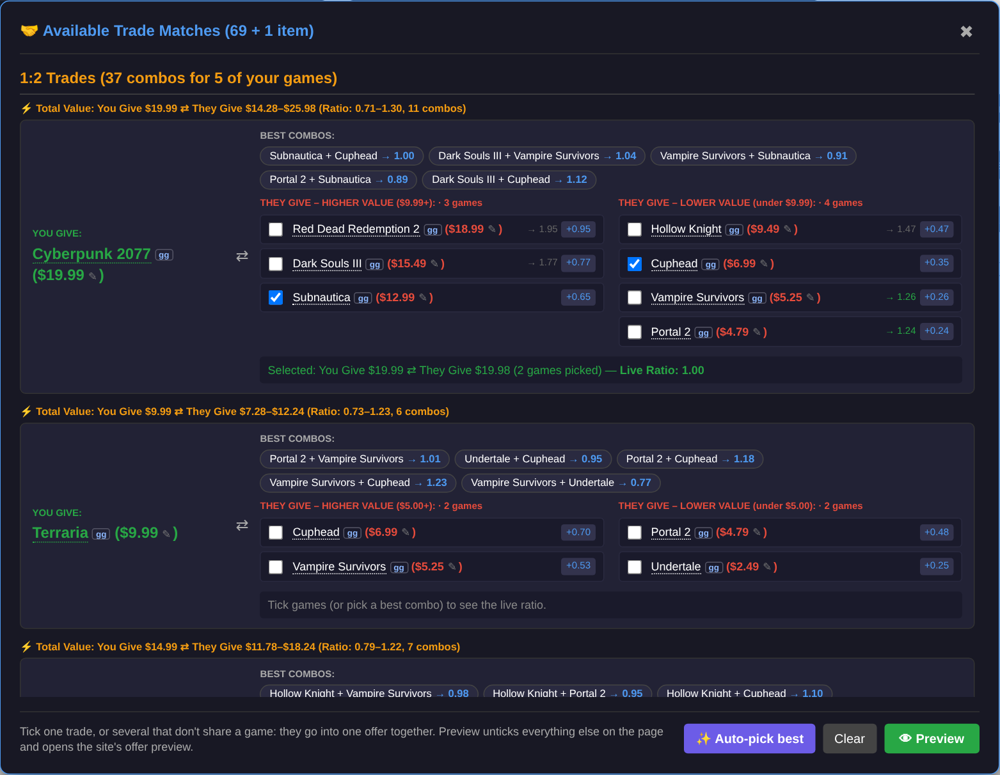
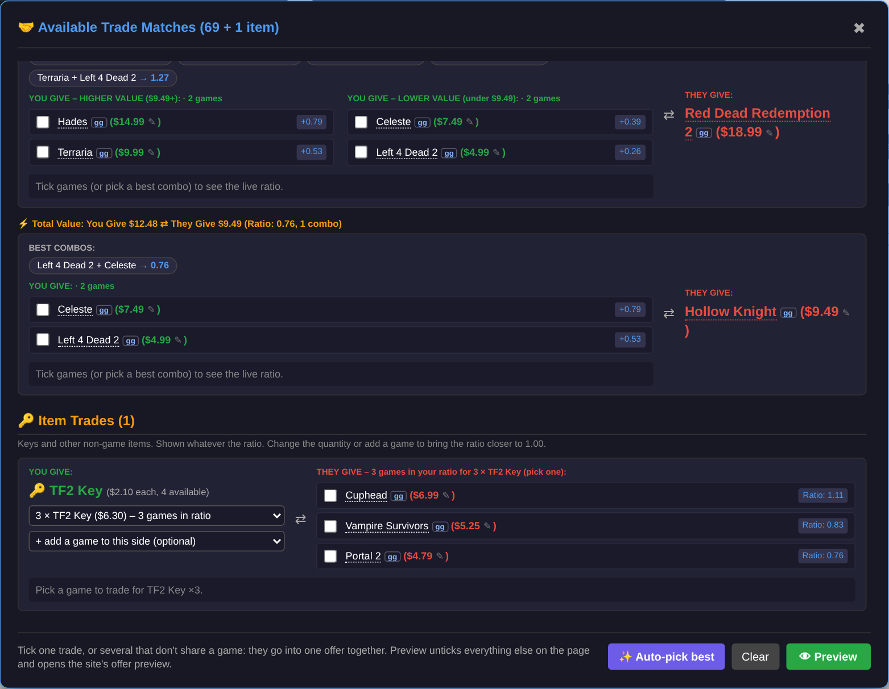
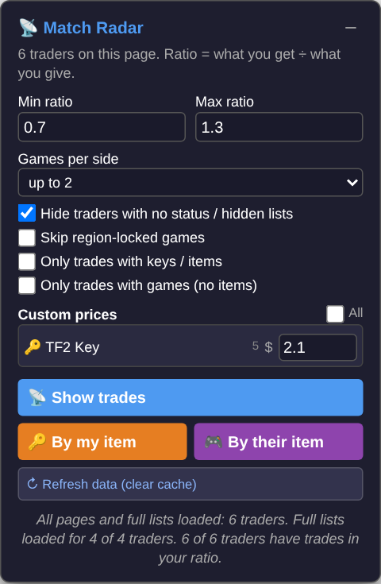
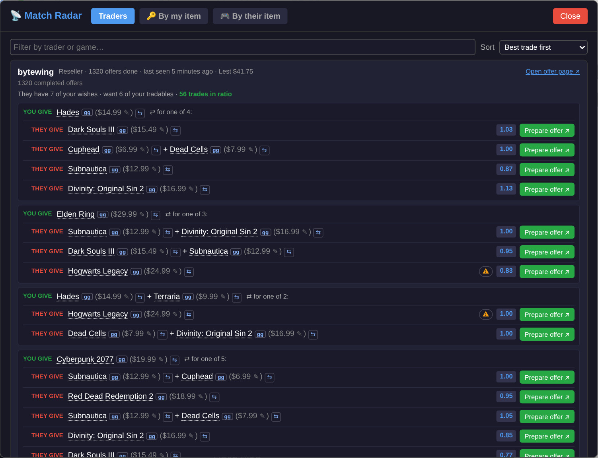
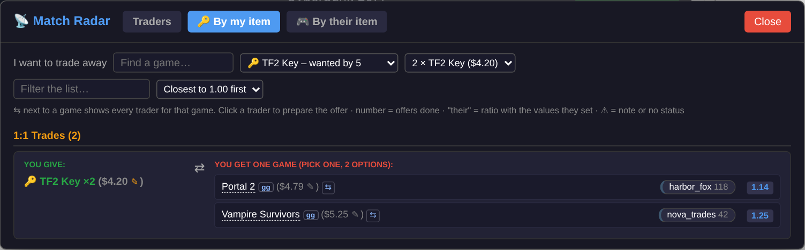
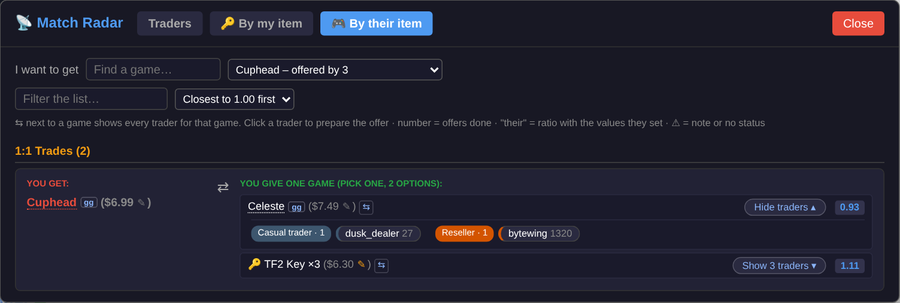

# 🔭 Lestrades Trade Scout

A userscript for [lestrades.com](https://lestrades.com) that finds fair trades for you, sorts them by how close they are to an even swap, and sets up the offer so you only have to look at the preview and send it.

> **Unofficial. Not affiliated with Lestrades.** It only reads the pages you are already looking at (plus the other `/matches/` pages and game pages on the same site) and ticks checkboxes on the offer form. It never sends an offer for you.

  

> All screenshots in this README show only the script's own panel and windows, filled with **mock data**: popular game names with made-up prices and made-up traders on a local test page. No real traders or accounts are shown.

---

## Features

### On an offer page (`/offer/?u=…`)

- **Scan Trades**: match one game (or the games you ticked) against everything on the other side, in either direction (*my game → their games*, or *their game → my games*).
- **Open Scan**: no selection needed. Scans every game on both sides and lists the best matches.
- **Ratio from your point of view** (*what you get ÷ what you give*), sorted closest to 1.00 first. Min/Max ratio are adjustable (default 0.7–1.3).
- **1:1, 1:2, 1:3, 2:1, 3:1 trades**, grouped so a long list stays readable:
  - 1:1 trades sharing a game are grouped as "pick one of N" lists.
  - 1:2 / 1:3 trades are shown as one card per game with the best combos on top, a live ratio bar, value bands, a name filter, and "only games that fit with your pick" narrowing after the first tick.
- **Several trades in one offer**: tick more than one 1:1 trade as long as they don't share a game, or press **Auto-pick best** to take the best trade of every group.
- **🔑 Item Trades**: keys and other non-game items get their own section with a quantity picker and the games that fit each quantity. A **Games only** checkbox hides this section.
- **One-click Preview**: unticks everything else on the page, ticks the chosen trade, sets amounts and clicks the site's own *Preview Offer* button.
- **Custom prices**: items without a price on the page are listed so you can set one. A small ✎ next to any price edits it in place. Prices are saved per game title and only the ones on the current page are listed.
- **Links**: every game name opens its Steam page; a small `gg` badge opens it on GG.deals.

**Open Scan results**, with 1:1 trades grouped by shared game:

**1:2 / 1:3 cards** (and the mirrored 2:1 / 3:1 cards) show the best combos, value columns and a live ratio for whatever you tick:

**Item Trades**: keys and other items get their own section, with a quantity picker:

### On the matches pages (`/matches/`): Match Radar

- Reads every trader on the list and finds trades inside your ratio range with your tradables.
- **Loads everything automatically**: all other pages of the list (`?start=100`, `200`, … up to the last page shown) and each trader's full list. Results are **cached for 30 minutes** (see [Loading and caching](#loading-and-caching)).
- **Badges** in the top-right corner of every trader's list (e.g. `📡 6 trades · best 1.07`). They float over the list, so the site's own header (Send Offer, Skip, …) keeps its layout. Click one to jump to that trader.
- **Traders window**: one card per trader with the best few ways to trade, region locks, their own estimated values and "may keep" notes.
- **By my item** window: pick one of your items (and an amount for keys), and see every game you could get for it, one line per game. A *Show N traders* button lists the traders for that game, grouped by type (Casual / Reseller / Retrader, plus a *likely reseller* guess), with how many offers they have completed and their own ratio when they set values.
- **Trader notes** (region locks, "may keep", their own values) show as a small 📝 / ⚠ icon on the row: hover for the text or click to open it under the row. *Prepare offer* is always the last button on the right.
- **By their item** window: the mirror image. Pick one of the games the traders have (there is a "Find a game…" box to narrow the list), and see everything of yours you could give for it, one line per option, with the traders who have it behind a *Show N traders* button.
- **Switch quickly between views**: a small ⇆ next to any game in any list jumps to every trader for that game (*By their item* for their games, *By my item* for yours), and **← Back** returns to where you were.
- **Filtered pages**: `/matches/?wid=ID` (a game you want) opens *By their item* for that game, and `/matches/?tid=ID` (a game you have that they want) opens *By my item* for it, automatically.
- **Prepare offer ↗** opens that trader's offer page and ticks the trade there, ready to preview.
- Options: ratio range, 1 or 2 games per side, hide traders with no status, skip region-locked games, only trades with items, only trades with games.

The **Match Radar panel** holds the settings. It also adds a small badge in the corner of every trader's list on the page (e.g. `📡 6 trades · best 1.07`):

  

The **Traders window** ranks every trader by their best trade:

**By my item**: pick one of your items and see every game it could get you:

**By their item**: pick a game you want, see what you could give for it and which traders have it, grouped by trader type:

---

## Install

1. Install a userscript manager, e.g. [Tampermonkey](https://www.tampermonkey.net/) (Chrome, Edge, Firefox, Safari) or [Violentmonkey](https://violentmonkey.github.io/).
2. Open the raw script and let the manager install it:

   **[`lestrades-trade-scout.user.js`](lestrades-trade-scout.user.js)**

3. Open any offer page or matches page on lestrades.com. A panel appears on the right.

The script only runs on `lestrades.com` and `www.lestrades.com`.

---

## Using it

### Offer page

1. Pick **Match Direction**.
2. Pick a game from the dropdown, or leave it blank and tick games on the page yourself.
   - A game chosen in the dropdown always wins over ticked rows on that side.
   - Rows ticked by a previous *Preview* are not treated as your selection.
3. Click **🔍 Scan Trades** (or **🌐 Open Scan** for everything).
4. In the results, tick a trade (or a combo / best-combo button for 1:2 cards) and press **👁 Preview**.
5. Check the site's preview and send the offer yourself.

### Matches page

1. Open `/matches/` (or `/matches/?u=…` for one trader). The panel loads the other pages and full lists in the background; progress is shown in the status line.
2. **📡 Show trades** (full width) for the trader view, **🔑 By my item** or **🎮 By their item** for the item views.
3. **Prepare offer ↗** opens the offer page in a new tab with the trade ready to preview.

---

## Settings

| Setting | Where | Notes |
|---|---|---|
| Min / Max ratio | both panels | Ratio = get ÷ give. Default 0.7–1.3. Everything shown is inside this range. |
| Max Their Games (1–3) | offer page | 3 enables 1:3 trades. |
| Games only | offer page | Hides the Item Trades section. Remembered. |
| Games per side (1–2) | matches page | 2 adds the 1:2 sections. |
| Hide traders with no status / hidden lists | matches page | |
| Skip region-locked games | matches page | |
| Only trades with keys / items, Only trades with games | matches page | Exclude each other. |
| Custom prices | both panels | Saved by game title. Leave empty to use the site's price. |
| ↻ Refresh data (clear cache) | matches page | Forgets the cached lists and reloads the page. See below. |

---

## Loading and caching

Match Radar needs a lot of pages to build its results (every page of the list, plus the full list of each trader who shows only a partial one). To keep that gentle on the site:

- **Requests are paced**: a few at a time, started at most about 8 per second overall. If the server starts answering slowly, the script spaces requests out further by itself and speeds up again when it recovers.
- **Only what you can see is loaded.** Traders hidden by *Hide traders with no status* are skipped (untick the option and their lists are loaded then), and traders that already look promising are loaded first, so useful results show up early.
- **Results are cached for 30 minutes** in your browser (IndexedDB, under the name `trade-scout`). Reloading `/matches/` within that time makes no extra requests for lists that are already cached; the status line shows how many came from cache. The page you are looking at is always read live.
- **It backs off when the server asks it to.** On an HTTP 429 or 503 the script waits (using the `Retry-After` header when there is one, otherwise a few seconds), retries twice, and then **stops loading** and tells you so. What is already loaded is kept. The **Load full list** button on a trader retries manually.
- Expired cache entries are cleaned up automatically.

**Cached data does not know about changes to your own lists.** If you add or remove wishes or tradables on Lestrades, press **↻ Refresh data (clear cache)** so the next load fetches fresh data. The same applies if you switch accounts in the same browser. Custom prices are never cached: they are applied live on top of the cached data, so changing a price takes effect immediately.

The cache only holds public list data that the site already showed you (game ids, titles, prices, amounts, trader names and counts). It stays in your browser and can be cleared at any time with the button above or through your browser's site-data settings.

---

## Notes and limitations

- **Prices** come from the page (the site's own value for each game). Games without a price are skipped until you give them a custom price.
- **Trader type** uses the status the site shows. When it says nothing, a trader is flagged *likely reseller* if they match 80+ of your wishes or have 1000+ offers done. That is a guess, not data from the site.
- **"Their" ratio** on a trader chip uses the values that trader set on the items, and only appears when they set any.
- **GG.deals links** use the exact page when the site provides it, otherwise the script looks it up from the game's Lestrades page the first time, and falls back to a GG.deals search.
- Loading other pages relies on the `?start=` page links shown at the bottom of `/matches/`. If the site changes its pagination, the page loader may stop finding pages.
- The first load of a long list (a few hundred traders) takes around half a minute because of the pacing above. Loading again within 30 minutes uses the cache and is near-instant.
- The Traders window shows 40 traders at a time (*Show more traders* at the bottom) so it opens quickly even with hundreds of traders.
- Scans of very large lists are capped (very large combination counts are skipped) to keep the page responsive.
- The script relies on Lestrades' current page structure. If the site changes, parts of it may break.

---

## FAQ

<b>Does it send offers for me?</b>

No. It ticks the boxes and opens the site's own preview, and you check it and send the offer yourself.

<b>What does the ratio mean?</b>

Ratio = what you get ÷ what you give. 1.00 is an even swap, above 1 you receive more value than you give, below 1 you receive less. Results are inside your Min/Max range and sorted closest to 1.00 first.

<b>A game I expected is missing from the results. Why?</b>

The usual reasons:

- **It has no price.** Games and items without a price are skipped until you set a custom price in the panel.
- **It's outside your ratio range.** Widen Min/Max.
- **The price gap inside a combo is extreme.** Combos where the most expensive game is more than about 3.2× the cheapest (and over $4.50 apart) are left out.
- **The list is capped.** Open Scan keeps the best matches per game, and very large combination counts are skipped. Tick some games and use **Scan Trades** for a narrower, fuller search.
- **On the matches page:** the trader may be hidden by *Hide traders with no status*, or the game is region-locked and *Skip region-locked games* is on.

<b>Why does Match Radar take a while the first time?</b>

It loads every page of the list and each trader's full list, and it paces those requests on purpose to stay gentle on the site. A few hundred traders take around half a minute. Results are then cached for 30 minutes, so reloading is near-instant. See [Loading and caching](#loading-and-caching).

<b>The results look out of date after I changed my wishes or tradables.</b>

Press **↻ Refresh data (clear cache)** in the Match Radar panel. The cache can't see changes you make on the site. It also applies if you switch accounts in the same browser.

<b>What is "likely reseller"?</b>

When a trader has no status set, the script guesses: 80+ games matching your wishes or 1000+ completed offers. It is a guess, not data from the site.

<b>Prepare offer opened the page but nothing was ticked.</b>

The status line on the offer page says what it couldn't find. Tick the games yourself and click Preview offer. This can happen if the trader's lists changed since you loaded the radar. Use **Refresh data** and try again.

<b>Where is my data stored, and how do I reset it?</b>

Settings and custom prices are stored with your userscript manager. The list cache is in your browser's IndexedDB for lestrades.com. **Refresh data** clears the cache. To remove everything, clear the site's data in your browser settings and delete the script's storage in your userscript manager.

<b>Is it allowed to use a script like this?</b>

I can't speak for the site. The script only reads pages you open (plus other pages on the same site, at a limited pace) and never submits anything for you, but check Lestrades' own rules if you are unsure.

<b>It stopped working after a site update.</b>

The script reads Lestrades' current page layout, so a redesign can break parts of it. When you report a problem, say which page it was (offer or matches), which options you used, and include any message from the status line or the browser console.

---

## Privacy

Everything runs in your browser. The script makes requests only to `lestrades.com` (other `/matches/` pages and game pages) and opens Steam / GG.deals links only when you click them. Settings and custom prices are stored with your userscript manager (`GM_setValue`); the list cache lives in your browser's IndexedDB for the site. Nothing is sent anywhere else.

---

## Author

Made by **eddie-the-eagle**.

## License

Licensed under the **GNU General Public License v3.0 or later** (GPL-3.0-or-later). See [LICENSE](LICENSE).

In short: you are free to use, modify and share this script. If you share a modified version, it has to stay under the same license and come with its source. It comes with no warranty.
