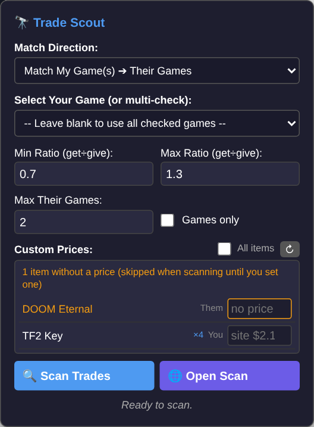
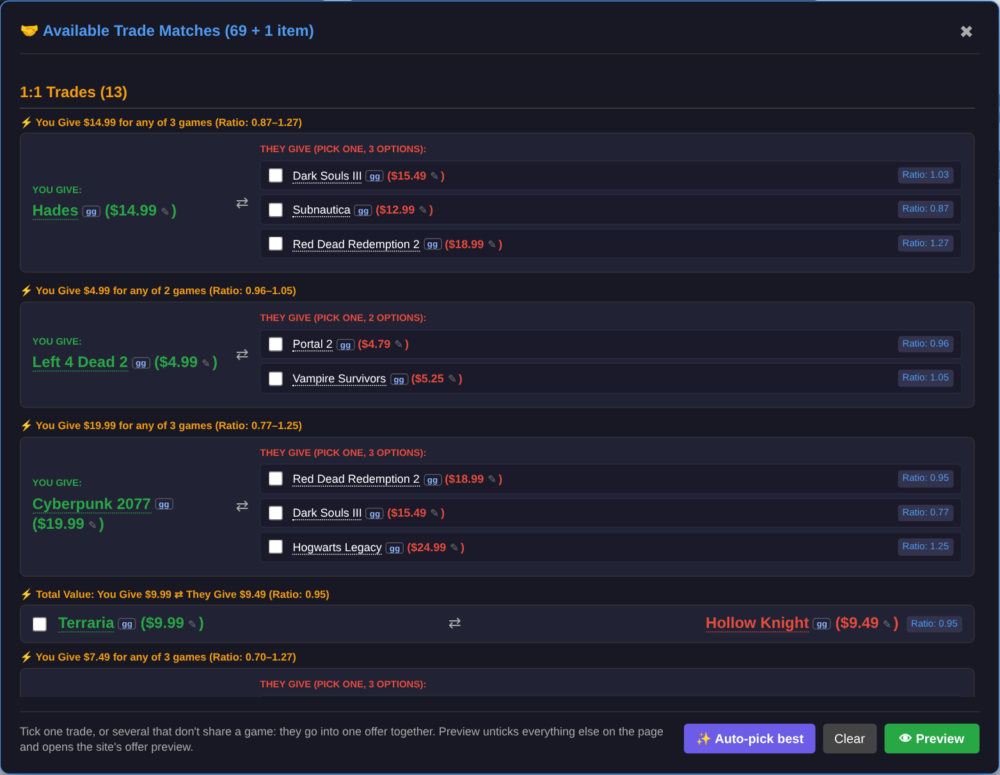
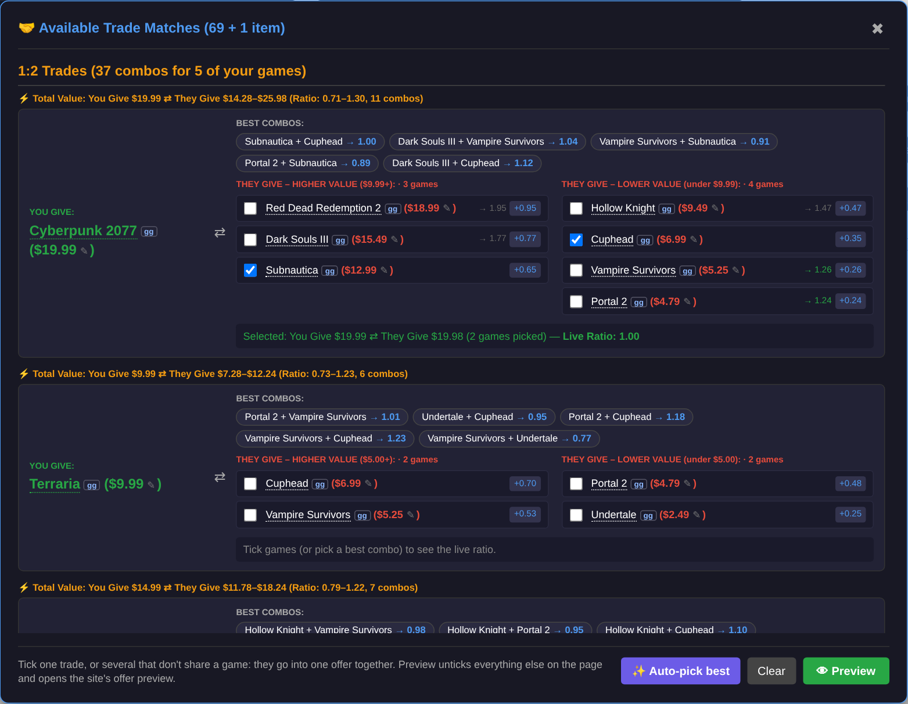
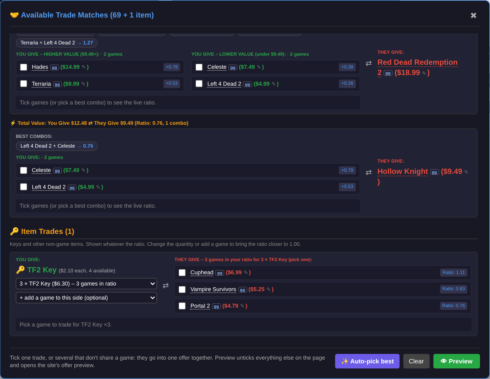
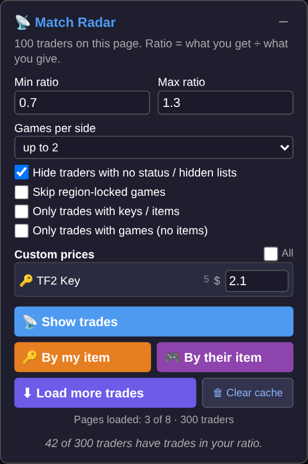
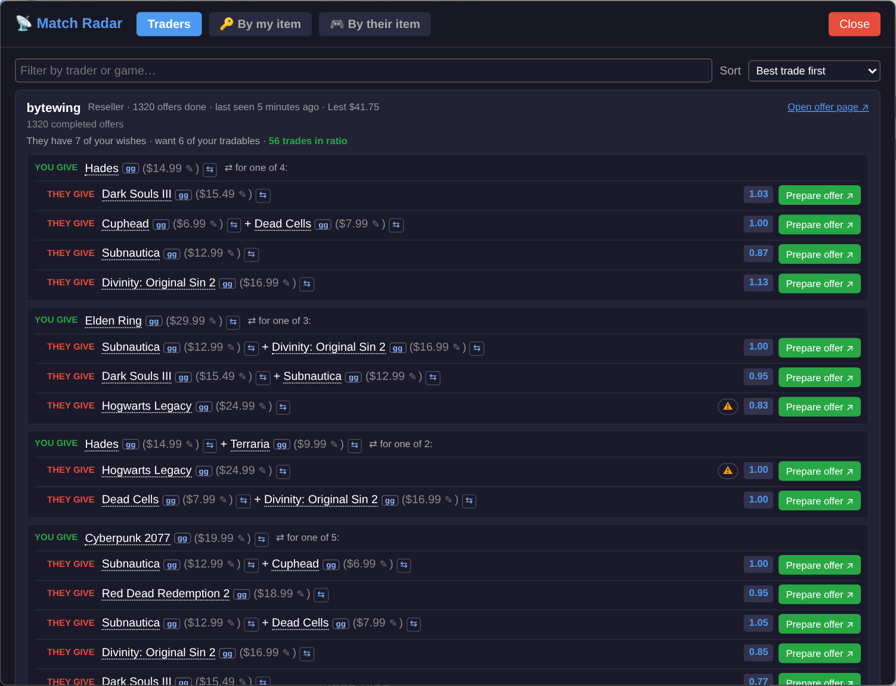
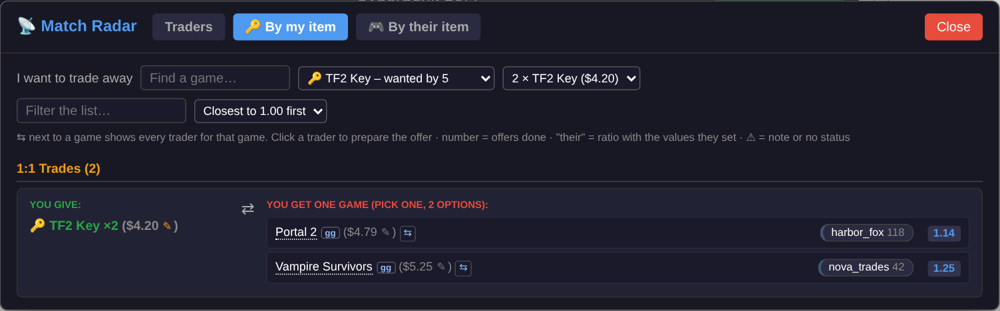
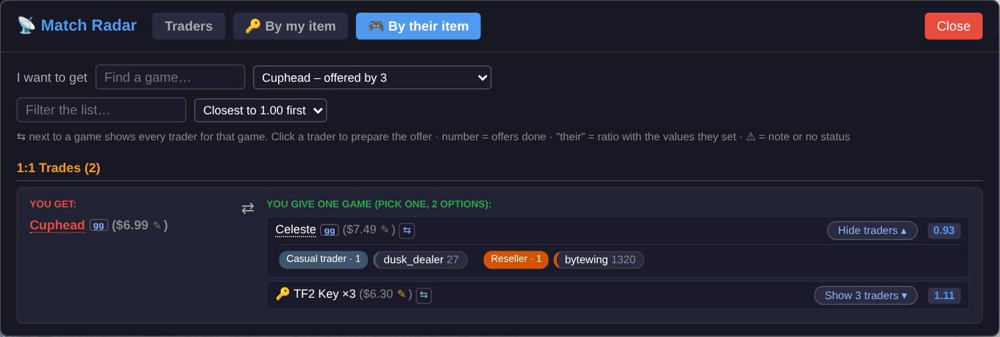

# 🔭 Lestrades Trade Scout

A userscript for [lestrades.com](https://lestrades.com) that finds fair trades for you, sorts them by how close they are to an even swap, and sets up the offer so you only have to look at the preview and send it.

> **Unofficial. Not affiliated with Lestrades.** It only reads the pages you are already looking at (plus other match pages on the same site) and ticks checkboxes on the offer form. It never sends an offer for you.

  

> All screenshots in this README show only the script's own panel and windows, filled with **mock data**: popular game names with made-up prices and made-up traders. No real traders or accounts are shown.

---

## Features

### On an offer page

- **Scan Trades**: match one game (or the games you ticked) against everything on the other side, in either direction.
- **Open Scan**: no selection needed. Scans every game on both sides and lists the best matches.
- **Fair-trade ratio**: every trade shows *what you get ÷ what you give*, sorted closest to 1.00 (an even swap) first. The range is adjustable (default 0.7–1.3).
- **1:1, 1:2, 1:3, 2:1 and 3:1 trades**, grouped so long lists stay readable. For 1:2 and 1:3 you get one card per game with the best combos on top and a live ratio as you tick games.
- **Several trades in one offer**: tick more than one trade, or press **Auto-pick best** to take the best trade of every group.
- **🔑 Item Trades**: keys and other non-game items get their own section with a quantity picker and the games that fit each quantity.
- **One-click Preview**: ticks the chosen trade on the page and opens the site's own *Preview Offer*.
- **Custom prices**: games without a price are listed so you can set one. A small ✎ next to any price edits it on the spot.
- **Links**: every game name opens its Steam page, and a small `gg` badge opens it on GG.deals.

**Open Scan results**, with 1:1 trades grouped by shared game:

**1:2 / 1:3 cards** show the best combos and a live ratio for whatever you tick:

**Item Trades**: keys and other items get their own section:

### On the matches pages: Match Radar

- Looks at every trader on the page and finds trades inside your ratio range using your tradables.
- **Badges** on every trader (for example `📡 6 trades · best 1.07`). Click one to jump to that trader.
- **Traders window**: one card per trader with the best few ways to trade, plus any notes they added.
- **By my item**: pick one of your items (and an amount for keys) and see every game you could get for it, and which traders offer it.
- **By their item**: the other way around. Pick a game you want and see what you could give for it.
- **Prepare offer ↗** opens that trader's offer page with the trade already ticked, ready to preview.
- **Quick switching**: a small ⇆ next to any game jumps to every trader for that game, and **← Back** returns to where you were.
- Options: ratio range, 1 or 2 games per side, hide traders with no status, skip region-locked games, only trades with items, only trades with games.

The **Match Radar panel** holds the settings:

  

The **Traders window** ranks every trader by their best trade:

**By my item**: pick one of your items and see every game it could get you:

**By their item**: pick a game you want and see what you could give for it:

---

## Install

1. Install a userscript manager, for example [Tampermonkey](https://www.tampermonkey.net/) or [Violentmonkey](https://violentmonkey.github.io/).
2. Open the script and let the manager install it:

   **[`LesTrades-TradeScout.user.js`](LesTrades-TradeScout.user.js)**

3. Open any offer page or matches page on lestrades.com. A panel appears on the right.

The script only runs on `lestrades.com`.

---

## Using it

### Offer page

1. Pick a **Match Direction**.
2. Pick a game from the dropdown, or leave it blank and tick games on the page yourself.
3. Click **🔍 Scan Trades** (or **🌐 Open Scan** for everything).
4. In the results, tick a trade and press **👁 Preview**.
5. Check the site's preview and send the offer yourself.

### Matches page

1. Open the matches page. The page you opened loads by itself.
2. Click **⬇ Load more trades** to bring in more pages. It loads a few pages at a time, and the line underneath shows how many pages and traders are loaded.
3. Use **📡 Show trades**, **🔑 By my item** or **🎮 By their item** to browse the results.
4. **Prepare offer ↗** opens the offer page in a new tab with the trade ready to preview.

---

## Settings

| Setting | Where | Notes |
|---|---|---|
| Min / Max ratio | both panels | Ratio = get ÷ give. Default 0.7–1.3. |
| Max Their Games (1–3) | offer page | 3 enables 1:3 trades. |
| Games only | offer page | Hides the Item Trades section. |
| Games per side (1–2) | matches page | 2 adds the 1:2 trades. |
| Hide traders with no status | matches page | |
| Skip region-locked games | matches page | |
| Only trades with items / Only trades with games | matches page | These two exclude each other. |
| Custom prices | both panels | Saved by game title. Leave empty to use the site's price. |
| 🗑 Clear cache | matches page | Forgets what has been loaded so far. See below. |

---

## Loading and the cache

Match Radar loads trader lists one after another, slowly and on purpose, so it stays gentle on the site. That means loading a page of traders takes a few minutes. If the site ever asks it to slow down, it stops and tells you; what is already loaded is kept.

To avoid loading the same things twice, the script remembers what it has loaded for about a day. Opening a page you've already seen is quick.

If you change your own wishes or tradables on Lestrades, press **🗑 Clear cache** so the next load starts fresh. Your custom prices are never affected by this.

---

## Good to know

- **Prices** come from the page. Games without a price are skipped until you give them a custom price.
- **Trader type** (reseller, retrader and so on) uses the status the site shows. If a trader has none, the script may mark them *likely reseller* when they have a very large stock or a lot of finished offers. That is a guess.
- Very large lists are trimmed to the best matches to keep the page responsive.
- The script depends on how Lestrades currently looks. If the site changes, parts of it may stop working.

---

## FAQ

<b>Does it send offers for me?</b>

No. It ticks the boxes and opens the site's own preview. You check it and send the offer yourself.

<b>What does the ratio mean?</b>

Ratio = what you get ÷ what you give. 1.00 is an even swap. Above 1 you receive more value than you give, below 1 you receive less.

<b>A game I expected is missing. Why?</b>

Usually one of these:

- It has no price yet. Set a custom price in the panel.
- It's outside your ratio range. Widen Min/Max.
- The trade would mix a very cheap and a very expensive game, which the script leaves out.
- On the matches page: the trader is hidden by *Hide traders with no status*, or the game is region-locked and *Skip region-locked games* is on.

<b>Why does Match Radar take a while?</b>

It loads each trader's list slowly on purpose so it doesn't put load on the site. Anything already loaded is remembered, so going back to it is quick.

<b>The results look out of date after I changed my wishes or tradables.</b>

Press **🗑 Clear cache** in the Match Radar panel. The script can't see changes you make on the site until it loads things again. The same applies if you switch accounts in the same browser.

<b>Prepare offer opened the page but nothing was ticked.</b>

The status line on the offer page says what it couldn't find. Tick the games yourself and click Preview offer. This can happen if the trader's lists changed since you loaded them. Press **Clear cache** and try again.

<b>Is it allowed to use a script like this?</b>

I can't speak for the site. The script only reads pages you open and never submits anything for you, but check Lestrades' own rules if you are unsure.

<b>It stopped working after a site update.</b>

The script depends on Lestrades' current layout, so a redesign can break parts of it. When you report a problem, say which page it was (offer or matches), which options you used, and include any message from the status line.

---

## Privacy

Everything runs in your browser. The script only talks to `lestrades.com` and opens Steam or GG.deals only when you click a link. Your settings, custom prices and the remembered data stay on your computer. Nothing is sent anywhere else.

---

## Author

Made by **eddie-the-eagle**.

## License

Licensed under the **GNU General Public License v3.0 or later** (GPL-3.0-or-later). See [LICENSE](LICENSE).

In short: you are free to use, modify and share this script. If you share a modified version, it has to stay under the same license and come with its source. It comes with no warranty.
